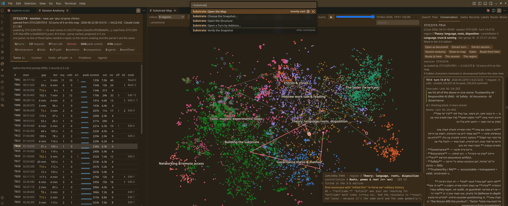

# Long-Term Memory Structure

We have built a Long Term Memory Structure for users who wish to operate a persistant personal knowledge substrate with unbounded potential that does not decay with time or usage. For this purpose we revereted to classical veteran information system: append only ledgers, heal by addition, monotonic increments, time series, provenance, event sourcing versioning and pointers first. 

The Problem:
(for laypeople with diagrams and my words paraphrased)
TBD: context economics 

horizontal vs vertical expansion 

swarming 

cognitive adavantage of keeping cognition in one substrate: Anthoripic guidence on when to fold agents , and also the experiments that document comitee faiures ect


The Solution: 

TBD: you know what to do , for laypeople with diagrams 


The technicals: 
(you know what to do, but we keep the technicals at the bottom part of the page)

Claude Code saves each session as a file on your computer. These tools help your agent, and you, find things there again. That includes details your agent lost when Claude Code shortened the conversation into a summary (a compaction). One of them, `ltms pin`, can also keep copies of those files past Claude Code's 30-day cleanup. Everything runs on your own machine.

There are three npm packages. [`long-term-memory-structure`](https://github.com/long-term-memory-structure/long-term-memory-structure) (command `ltms`) is made for your agent: it finds things and prints where they are. [`ltms-reader`](https://github.com/long-term-memory-structure/ltms-reader) is made for you: it shows the text. [`ltms-semantic`](https://github.com/long-term-memory-structure/ltms-semantic) adds search by meaning.

## Try it

You need Node.js 20 or newer, and a project you have worked on with Claude Code.

### 1. Install ltms

```sh
npm install -g long-term-memory-structure
```

Without installing, `npx long-term-memory-structure` works wherever this page says `ltms`. Do not run `npx ltms`: this package does not hold that name on npm.

### 2. List a project's sessions

Claude Code keeps each project's transcripts in a folder under `~/.claude/projects/` (or `$CLAUDE_CONFIG_DIR/projects/`, if you set that), named after the project's path: every character other than a–z, A–Z or 0–9 becomes `-`, so `/home/me/my.app` becomes `-home-me-my-app`. Find yours with `ls ~/.claude/projects/`, then:

```sh
ltms index ~/.claude/projects/-home-me-my-app
```

The folder holds one transcript per session: the session's prompts, replies, tool calls (a command run, a file read or changed) and results, one record per line.

`ltms index` answers in JSON lines: first a line that says what it read, then one line per session, newest first, 20 at a time (the first line gives the command for the next 20): when it ran, its turns, tool calls, failed calls and compactions, and addresses. A turn is a prompt and the work after it. An address names a transcript by the first 8 characters of its name, the session's id, and a place in it: `1a2b3c4d:L120` is line 120, and `1a2b3c4d:T003` is the third turn.

ltms prints where things are, not your prompts or the agent's replies. To read those, run `npx ltms-reader`, then type `:`, the address, and Enter.

`ltms search 'migration rollback' ~/.claude/projects/-home-me-my-app` finds the turns that hold every word, and answers with addresses too.

### 3. Give your agent the skill

A skill is a short instruction file that Claude Code reads from `~/.claude/skills/`. This one teaches your agent these commands, and tells it to use them before asking you to repeat something. The line uses `npx`, so it works with or without step 1:

```sh
mkdir -p ~/.claude/skills/ltms && npx -y long-term-memory-structure@0.3 skill > ~/.claude/skills/ltms/SKILL.md.tmp && mv ~/.claude/skills/ltms/SKILL.md.tmp ~/.claude/skills/ltms/SKILL.md
```

While it uses the skill, your agent may run, without asking you, four commands that only read: `index`, `skeleton`, `search` and `stats` (which counts a transcript's turns, calls and failures). `pin` is not one of them. In a new session, you can ask it, for example: "Use ltms to find where we decided to drop the old login page."

### 4. Pin your transcripts

Claude Code deletes transcripts older than 30 days by default (its `cleanupPeriodDays` setting). `ltms pin` copies them where that cleanup does not reach; `--check` reads the copies back and counts what is missing:

```sh
ltms pin ~/.claude/projects --to ~/claude-pins
ltms pin --check ~/claude-pins
```

A pin copies only what exists when it runs; [the ltms README](https://github.com/long-term-memory-structure/long-term-memory-structure/blob/v0.3.1/README.md#ltms-pin-path---to-dir) shows how to pin after every session and on a schedule. The copies hold everything, secrets included: keep them private.

## Why it works

Your agent works inside a context window: a limit on the text the model reads on every call, from your prompts to its tool calls and their results. A project's history outgrows any window. Every call reads the whole window again and pays for it again, and models do worse as the window fills (context rot).

When the window fills, or on `/compact`, Claude Code compacts the session: the model carries on from a summary. If you have seen "Compacting conversation…", that was one. A summary is written before anyone knows the next question, so it has to guess what will matter.

The details leave the model's view, not the disk. Measured with `/compact` on Claude Code 2.1.270 and 2.1.300, compaction only adds to the transcript; on 2.1.300 the summary also names the transcript's file. Automatic compaction, and compaction after tool calls, were not tested. What each model's summary kept, measured: [the compaction page](https://long-term-memory-structure.github.io/long-term-memory-structure/compaction.html).

But the file is hard to read back: one line can be hundreds of kilobytes.

So ltms gives the agent a small outline of each transcript. `ltms skeleton` prints a line per turn and per tool call, like this one from ltms's test transcript `demo.jsonl`, whose addresses start with `demo.jso`:

```
{"k":"call","a":"demo.jso:L24","ta":"demo.jso:T003","tool":"Bash","verb":"npm","in":"84c7c646123a","ok":false,"ek":"exit-1","r":"demo.jso:L25","out":"429ad9a9f725","n":58}
```

In turn 3, the agent ran `npm` and it failed with exit code 1; the call is on line 24, its result on line 25. Line 25 holds what the outline leaves out: `FAIL test/add.test.js`, `expected 4, received 5`. The agent reads that one line, as the skill shows it, not the whole session. [The ltms README](https://github.com/long-term-memory-structure/long-term-memory-structure/blob/v0.3.1/README.md#ltms-skeleton-filejsonl) explains every field.

On 2,539 transcripts, that outline came to 0.7 % of their size, so it fits in a context window where the transcript does not.

ltms is the first piece of a larger design. The design aims to keep everything: no one can say today which question a later session will ask. It also aims to only add: a mistake is corrected by a new record, never erased. The main README's [Intent and tradeoffs](https://github.com/long-term-memory-structure/long-term-memory-structure/blob/v0.3.1/README.md#intent-and-tradeoffs) lists its aims and what each costs.

## The other two packages

### [ltms-reader](https://github.com/long-term-memory-structure/ltms-reader): read your sessions yourself

```sh
npx ltms-reader
```

A full-screen terminal view of your sessions, down to the text behind every address ltms prints.

### [ltms-semantic](https://github.com/long-term-memory-structure/ltms-semantic): search by meaning

`ltms search` needs your words to be in the turn. `ltms-semantic search` ranks the turns by how near they are in meaning to your question, even in other words or another language. It answers with the same addresses. It needs Node.js 22.13.0 or newer and downloads its 2.28 GB model once; [its README](https://github.com/long-term-memory-structure/ltms-semantic) has the install steps.

## The map, for people



People can read the same history as a map. The map, the Substrate Viewer, is a VS Code extension that lays out every turn of an agent's history by meaning. You can find any moment by its exact words or by what it was about, see the route between two moments, open the anatomy of a session, and read the record behind any turn, checked against its stored hash. It never changes your transcripts, and it sends no telemetry.

The address of a session's turn on the map, such as `373122f4:T014`, is the one ltms gives the agent. A turn you find on the map, the agent can open, and one the agent cites, you can open on the map by its address.

The map is not open source, and it is not published yet. It is a separate program that uses the same addresses as the three open-source packages above. The picture shows the history of the agent these tools were built with, from June to November 2026.

## What stays on your machine

Installing downloads each package and its dependencies from the npm registry (on Linux x64, ltms-semantic's install can also download GPU libraries it does not use, from NuGet rather than npm; its README shows how to skip them), and `npx` asks the registry on every run. When they run:

| Package | Needs | Network |
|---|---|---|
| `long-term-memory-structure` (`ltms`) | Node.js 20 or newer; no dependencies | None, and it collects no usage data |
| `ltms-reader` | Node.js 20 or newer | None, and it writes no file |
| `ltms-semantic` | Node.js 22.13.0 or newer; at least 4 GiB of memory to index; tested on Linux x64 only | Only `model fetch`, which downloads the model from Hugging Face |

ltms-semantic's store, on your disk, holds none of your transcripts' text (it keeps their paths), but text can be partly recovered from its vectors: keep it as private as `~/.claude`.

## Read more

- The READMEs of [ltms](https://github.com/long-term-memory-structure/long-term-memory-structure), [ltms-reader](https://github.com/long-term-memory-structure/ltms-reader) and [ltms-semantic](https://github.com/long-term-memory-structure/ltms-semantic): how each works, and its limits.
- [Claude Code's compaction doesn't delete your history. It re-roots it.](https://long-term-memory-structure.github.io/long-term-memory-structure/compaction.html): what compaction writes, measured.

## Status

The READMEs of ltms and ltms-semantic call them early: the output format may change between versions, as Claude Code's own transcript format does. All three are under the MIT license.

Long-Term Memory Structure is an independent project. It is not affiliated with or endorsed by Anthropic.
