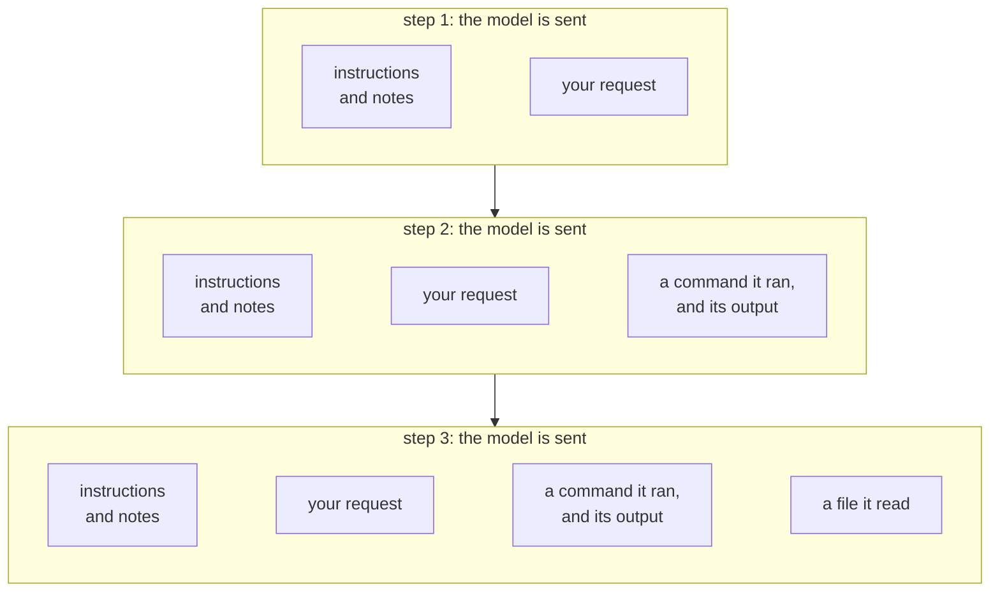
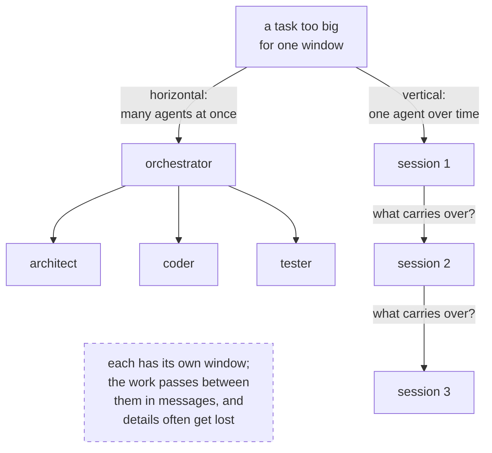
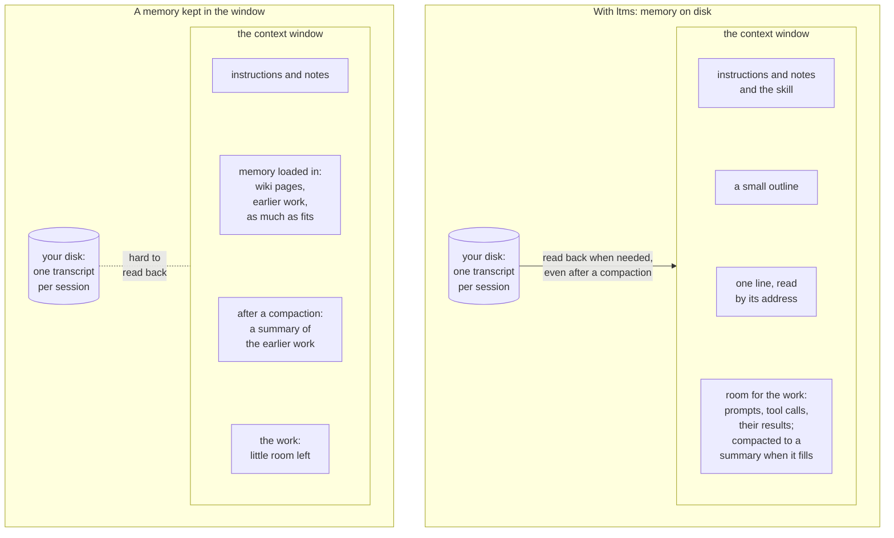
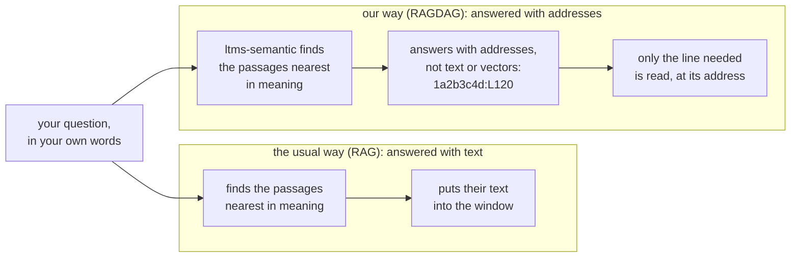
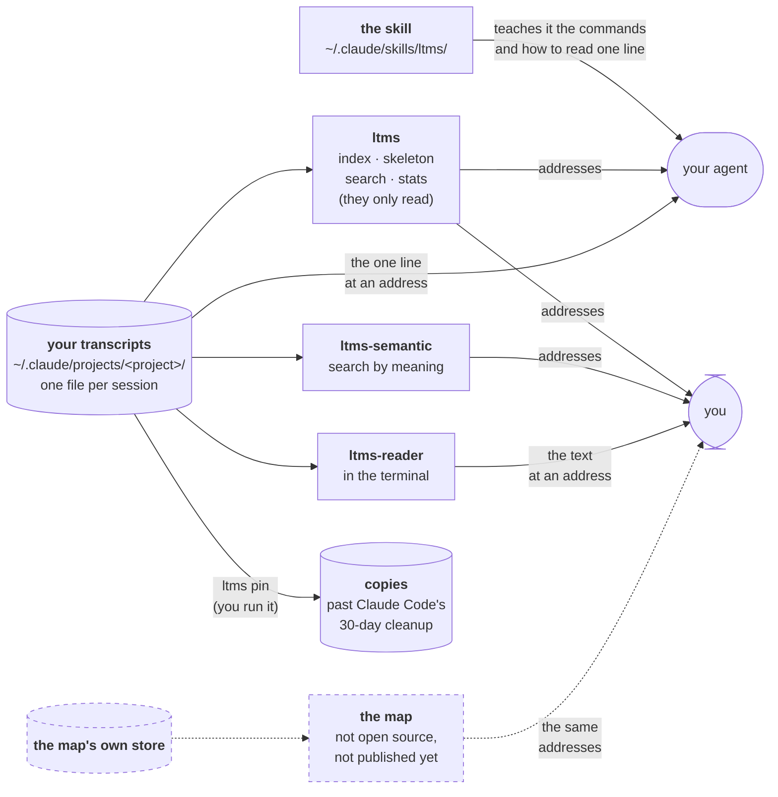
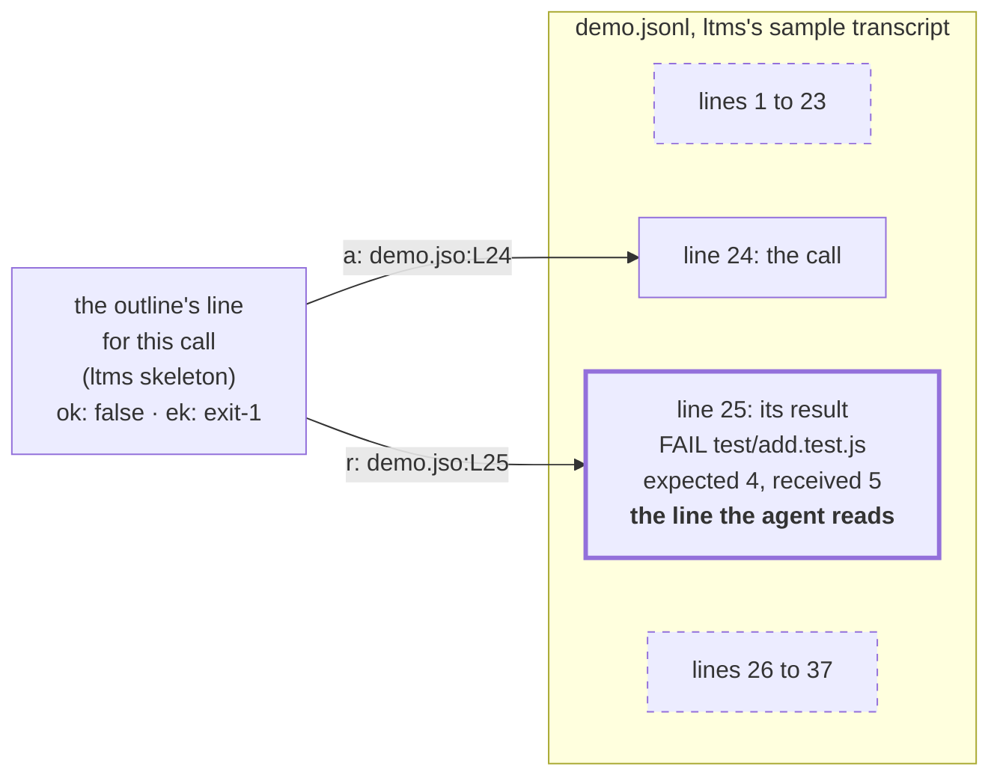

<!-- This file is assembled from sections/*.md and diagrams/*.mmd by tools/assemble.mjs. Edit those, then run: node tools/assemble.mjs -->

# Long-Term Memory Structure

We have built a Long Term Memory Structure for users who wish to operate a persistent personal knowledge substrate with unbounded potential that does not decay with time or usage. For this purpose we reverted to classical veteran information system: append only ledgers, heal by addition, monotonic increments, time series, provenance, event sourcing versioning and pointers first. 

In plain words: the design keeps everything an AI agent has done and only ever adds to it, and the agent reads back just the part it needs, by its address (every line of the record has one). The rest of this page explains why, and what you can use now.

## The Problem

### Memory is the costly part

An AI model reads and writes text in pieces called tokens; how many tokens a text makes depends on the model and the language. Its use is counted in tokens. Everything the model sees as it works is its context window: instructions, your messages, its replies, tool results. On Claude it holds up to 1 million tokens, depending on the model. Whatever the model is to remember of earlier work (the conversation so far, notes, a project's history) has to be in that window.

An agent is an AI model that works in a loop: it uses a tool, such as running a command, looks at the result, and decides the next step. Claude Code, Anthropic's coding agent, is one. It [sends "your full conversation with every request"](https://code.claude.com/docs/en/costs), so a one-line question in a conversation open all day "still draws usage for the whole conversation".



So a fuller window costs more at every step, and works worse: as it fills, models [lose accuracy](https://www.trychroma.com/research/context-rot), which Anthropic [calls context rot](https://platform.claude.com/docs/en/build-with-claude/context-windows).

A bigger window does not end this: a lasting memory keeps growing, and outgrows any window. Even if models stopped losing track of long inputs, every step would still carry the whole window.

### Many agents at once, or one agent over time

A large project can take, by our estimate, 10 to 100 million tokens of work. It has to be split: across agents at once (horizontally), or across time (vertically), one agent going from session to session (a session is one conversation, start to end).



Split across agents, the work is a swarm, of one of two kinds. Many agents can work on the same question as many tries: that is how a question is answered when no direct method is known, and a direct method, where one exists, costs far less. Or the work is divided among roles, like a team: an orchestrator agent hands parts to an architect, a coder and a tester, each a subagent.

We have done better vertically: we wrote and published a software library over a month or two of research and prototyping, with one agent carrying all the reasoning from session to session. Good results came easier and cheaper; a committee has competing aims, miscommunicates, and its talk is overhead. That is our account, not a measurement.

Others report the same. [Anthropic's article on folding subagents into one agent](https://claude.com/resources/articles/building-agents-when-to-fold-subagents-into-your-main-agent-loop) found, across several enterprise deployments, that one agent with skills (instructions it loads only when needed) often did better than subagents, and often cost less. Between agents, it says, you "often lose details in the back and forth"; one agent that has seen each earlier step can connect them. Cognition's [Don't Build Multi-Agents](https://cognition.com/blog/dont-build-multi-agents) gives an example: two subagents can build a Flappy Bird game's background and bird in different styles, as neither sees the other's work. A 2025 study of teams of AI agents, [Why Do Multi-Agent LLM Systems Fail?](https://arxiv.org/abs/2503.13657) (an LLM, a large language model, is the kind of AI model this page is about), notes that such teams' gains on popular tests are "often minimal"; it gathers over 1,600 recorded runs of 7 popular multi-agent tools, and names 14 ways they fail.

Several agents do help in some cases, such as questions that branch into independent directions: [Anthropic's multi-agent research system](https://www.anthropic.com/research/multi-agent-research-system) outperformed a single agent by 90.2% on Anthropic's internal research evaluation, for example in identifying all the board members of the companies in the S&P 500's information technology sector. By Anthropic's count, one agent uses about 4 times the tokens of a chat, and a multi-agent system about 15 times, and such systems fit poorly where every agent needs the same context. Anthropic's article on folding subagents keeps them for three cases: a window so full that the agent measurably does worse; tasks that need to run in parallel, each in a fresh window that can be thrown away afterwards; an agent unsure which tools to use, or with conflicting instructions. Our rule: start another agent when one is already fully occupied and more work comes, not by default.

That works only if one agent, over time, has a memory of its earlier sessions that it can use without filling its window.

### Every session starts from zero

A new session starts with amnesia: what it needs must be put into the window again, where it takes room from the work.

A popular memory is a wiki: linked pages that the model keeps up. Karpathy's [LLM Wiki](https://gist.github.com/karpathy/442a6bf555914893e9891c11519de94f) says reading its index first "works surprisingly well at moderate scale (~100 sources, ~hundreds of pages)". We have seen such a memory work up to some 100 to 300 linked files, depending on their size, then rot: once loaded, it leaves too little room for the work. That is the shape Thomas Jiralerspong drew for productivity with AI, a peak and then a cliff, in [Chasing the Karpathy Peak (and Falling Off Slop Cliff)](https://blog.thomas.jiralerspong.com/p/chasing-the-karpathy-peak).

When the window fills, Claude Code compacts the session, showing "Compacting conversation…": the model carries on from a summary of the older part. The summary is written before anyone knows the next question, so it guesses what will matter. A memory kept in the window must also forget to make room, yet no one knows which record a later question will need: a security audit months later, say, of a tool call that looked innocent at the time. And an old note that no longer fits the task can throw the model off.

So a long-term memory has two demands in tension: a record that keeps growing, and as little of it as possible in the window. That is the problem this project works on.

## The Solution

We take the memory out of the window. With our open-source tools (ltms and two companions, below), your agent, and you, can still find and reread what was said or done in earlier sessions, or before a compaction. This already works with Claude Code, on your own computer.

### Outside the window, read by address

The design, in four rules:

1. **Keep everything.** Delete nothing to make room; let no summary replace the record. Correct a mistake with a new record, and keep both: this is what "append only ledgers" and "heal by addition" mean above.
2. **Keep it outside the window.** Claude Code already writes each session to a file on your computer, its transcript, one record per line: prompts, replies, tool calls, their results, and more. A compaction, as far as we measured, only adds to that file: the details leave the model's view, not the disk. (Claude Code deletes these files after 30 days by default; `ltms pin`, below, keeps copies.)
3. **Reach it by address.** Every line has an address, such as `1a2b3c4d:L120`: line 120 of the session whose file name begins `1a2b3c4d`.
4. **Read only the line needed.** The agent reads a small outline of a session (a line per turn and per tool call, each with its address; a turn is a prompt and the work after it), then, from the outline or a search, the one line it needs, not the whole session. The aim: a small fixed cost in every session (the skill's short description; the skill itself, a short instruction file that teaches your agent the commands, loads when it is used), and a small cost per search.

Below, the same context window, with a memory kept in it and with ltms.



### Search by meaning, answered with addresses

A search by meaning finds what was said even in other words. It turns each passage into an embedding (or vector): a list of numbers, close for passages close in meaning. The usual way, called RAG (retrieval-augmented generation), puts the nearest passages' text into the window. Ours, `ltms-semantic`, answers with addresses instead, not with the passages' text or their vectors; then you read only the line you need, word for word, at its address. We call this RAGDAG: `ltms-semantic` does it now, with ltms's turn and line addresses; in the larger design below, the addresses are hashes in a DAG (a directed acyclic graph).



### What exists now, and the larger design

Three open-source packages do rules 3 and 4, and part of rule 1, on your own machine:

- [`long-term-memory-structure`](https://github.com/long-term-memory-structure/long-term-memory-structure) (the command `ltms`) gives your agent the outline and the addresses, and finds the turns that hold given words. `ltms pin` keeps copies of the session files past Claude Code's cleanup; once it has copied a version of a file, ltms never deletes it or writes over it, except in the cases its README lists.
- [`ltms-reader`](https://github.com/long-term-memory-structure/ltms-reader) shows you the text at an address.
- [`ltms-semantic`](https://github.com/long-term-memory-structure/ltms-semantic) searches by meaning, and answers with the same addresses.

A map, a separate program, shows people the same history, by the same addresses. It is not open source or published yet; a picture is in the technicals below.

The larger design goes further; these are its ideas, not the packages' features. In the packages, an address is the start of a session file's name and a line or a turn in it. In the design, each record is filed under its hash, a short code computed from its contents, so a changed record no longer matches its code. Records point back to earlier ones by hash, a shape called a [DAG](https://docs.ipfs.tech/concepts/merkle-dag/) (the DAG in RAGDAG); a search by meaning answers with those hashes.

The technicals below show how to install and use ltms, how to open ltms-reader, and what ltms-semantic needs.

## The technicals

Who uses each package, and what it gives back:



### Try it

You need Node.js 20 or newer, and a project you have worked on with Claude Code.

#### 1. Install ltms

```sh
npm install -g long-term-memory-structure
```

Without installing, `npx long-term-memory-structure` works wherever this page says `ltms`. Do not run `npx ltms`: this package does not hold that name on npm.

#### 2. List a project's sessions

Claude Code keeps each project's transcripts in a folder under `~/.claude/projects/` (or `$CLAUDE_CONFIG_DIR/projects/`, if you set that), named after the project's path: every character other than a–z, A–Z or 0–9 becomes `-`, so `/home/me/my.app` becomes `-home-me-my-app`. Find yours with `ls ~/.claude/projects/`, then:

```sh
ltms index ~/.claude/projects/-home-me-my-app
```

The folder holds one transcript per session: the session's prompts, replies, tool calls (a command run, a file read or changed) and results, one record per line.

`ltms index` answers in JSON lines: first a line that says what it read, then one line per session, newest first, 20 at a time (the first line gives the command for the next 20): when it ran, its turns, tool calls, failed calls and compactions, and addresses. A turn is a prompt and the work after it. An address names a transcript by the first 8 characters of its name, the session's id, and a place in it: `1a2b3c4d:L120` is line 120, and `1a2b3c4d:T003` is the third turn.

ltms prints where things are, not your prompts or the agent's replies. To read those, run `npx ltms-reader`, then type `:`, the address, and Enter.

`ltms search 'migration rollback' ~/.claude/projects/-home-me-my-app` finds the turns that hold every word, and answers with addresses too.

#### 3. Give your agent the skill

A skill is a short instruction file that Claude Code reads from `~/.claude/skills/`. This one teaches your agent these commands, and tells it to use them before asking you to repeat something. The line uses `npx`, so it works with or without step 1:

```sh
mkdir -p ~/.claude/skills/ltms && npx -y long-term-memory-structure@0.3 skill > ~/.claude/skills/ltms/SKILL.md.tmp && mv ~/.claude/skills/ltms/SKILL.md.tmp ~/.claude/skills/ltms/SKILL.md
```

While it uses the skill, your agent may run, without asking you, four commands that only read: `index`, `skeleton`, `search` and `stats` (which counts a transcript's turns, calls and failures). `pin` is not one of them. In a new session, you can ask it, for example: "Use ltms to find where we decided to drop the old login page."

#### 4. Pin your transcripts

Claude Code deletes transcripts older than 30 days by default (its `cleanupPeriodDays` setting). `ltms pin` copies them where that cleanup does not reach; `--check` reads the copies back and counts what is missing:

```sh
ltms pin ~/.claude/projects --to ~/claude-pins
ltms pin --check ~/claude-pins
```

A pin copies only what exists when it runs; [the ltms README](https://github.com/long-term-memory-structure/long-term-memory-structure/blob/v0.3.1/README.md#ltms-pin-path---to-dir) shows how to pin after every session and on a schedule. The copies hold everything, secrets included: keep them private.

### Why it works

The measurement behind rule 2 above: with `/compact` (the command that compacts a session on demand) on Claude Code 2.1.270 and 2.1.300, compaction only adds to the transcript; on 2.1.300 the summary also names the transcript's file. Automatic compaction, and compaction after tool calls, were not tested. What each model's summary kept, measured: [the compaction page](https://long-term-memory-structure.github.io/long-term-memory-structure/compaction.html).

But the file is hard to read back: one line can be hundreds of kilobytes.

So ltms gives the agent a small outline of each transcript. `ltms skeleton` prints a line per turn and per tool call, like this one from ltms's test transcript `demo.jsonl`, whose addresses start with `demo.jso`:

```
{"k":"call","a":"demo.jso:L24","ta":"demo.jso:T003","tool":"Bash","verb":"npm","in":"84c7c646123a","ok":false,"ek":"exit-1","r":"demo.jso:L25","out":"429ad9a9f725","n":58}
```



In turn 3, the agent ran `npm` and it failed with exit code 1; the call is on line 24, its result on line 25. Line 25 holds what the outline leaves out: `FAIL test/add.test.js`, `expected 4, received 5`. The agent reads that one line, as the skill shows it, not the whole session. [The ltms README](https://github.com/long-term-memory-structure/long-term-memory-structure/blob/v0.3.1/README.md#ltms-skeleton-filejsonl) explains every field.

On 2,539 transcripts, that outline came to 0.7 % of their size, so it fits in a context window where the transcript does not.

ltms is the first piece of a larger design. The main README's [Intent and tradeoffs](https://github.com/long-term-memory-structure/long-term-memory-structure/blob/v0.3.1/README.md#intent-and-tradeoffs) lists its aims and what each costs.

### The other two packages

#### [ltms-reader](https://github.com/long-term-memory-structure/ltms-reader): read your sessions yourself

```sh
npx ltms-reader
```

A full-screen terminal view of your sessions, down to the text behind every address ltms prints.

#### [ltms-semantic](https://github.com/long-term-memory-structure/ltms-semantic): search by meaning

`ltms search` needs your words to be in the turn. `ltms-semantic search` ranks the turns by how near they are in meaning to your question, even in other words or another language. It needs Node.js 22.13.0 or newer and downloads its 2.28 GB model once; [its README](https://github.com/long-term-memory-structure/ltms-semantic) has the install steps.

### The map, for people


The map, the Substrate Viewer, is a VS Code extension that lays out every turn of an agent's history by meaning. You can find any moment by its exact words or by what it was about, see the route between two moments, open the anatomy of a session, and read the record behind any turn, checked against its stored hash. It never changes your transcripts, and it sends no telemetry.

The address of a session's turn on the map, such as `373122f4:T014`, is the one ltms gives the agent. A turn you find on the map, the agent can open, and one the agent cites, you can open on the map by its address.

The map is not open source, and it is not published yet. It is a separate program that uses the same addresses as the three open-source packages above. The picture shows the history of the agent these tools were built with, from June to November 2026.

### What stays on your machine

Installing downloads each package and its dependencies from the npm registry (on Linux x64, ltms-semantic's install can also download GPU libraries it does not use, from NuGet rather than npm; its README shows how to skip them), and `npx` asks the registry on every run. When they run:

| Package | Needs | Network |
|---|---|---|
| `long-term-memory-structure` (`ltms`) | Node.js 20 or newer; no dependencies | None, and it collects no usage data |
| `ltms-reader` | Node.js 20 or newer | None, and it writes no file |
| `ltms-semantic` | Node.js 22.13.0 or newer; at least 4 GiB of memory to index; tested on Linux x64 only | Only `model fetch`, which downloads the model from Hugging Face |

ltms-semantic's store, on your disk, holds none of your transcripts' text (it keeps their paths), but text can be partly recovered from its vectors: keep it as private as `~/.claude`.

### Read more

- The READMEs of [ltms](https://github.com/long-term-memory-structure/long-term-memory-structure), [ltms-reader](https://github.com/long-term-memory-structure/ltms-reader) and [ltms-semantic](https://github.com/long-term-memory-structure/ltms-semantic): how each works, and its limits.
- [Claude Code's compaction doesn't delete your history. It re-roots it.](https://long-term-memory-structure.github.io/long-term-memory-structure/compaction.html): what compaction writes, measured.

### Status

The READMEs of ltms and ltms-semantic call them early: the output format may change between versions, as Claude Code's own transcript format does. All three are under the MIT license.

Long-Term Memory Structure is an independent project. It is not affiliated with or endorsed by Anthropic.
